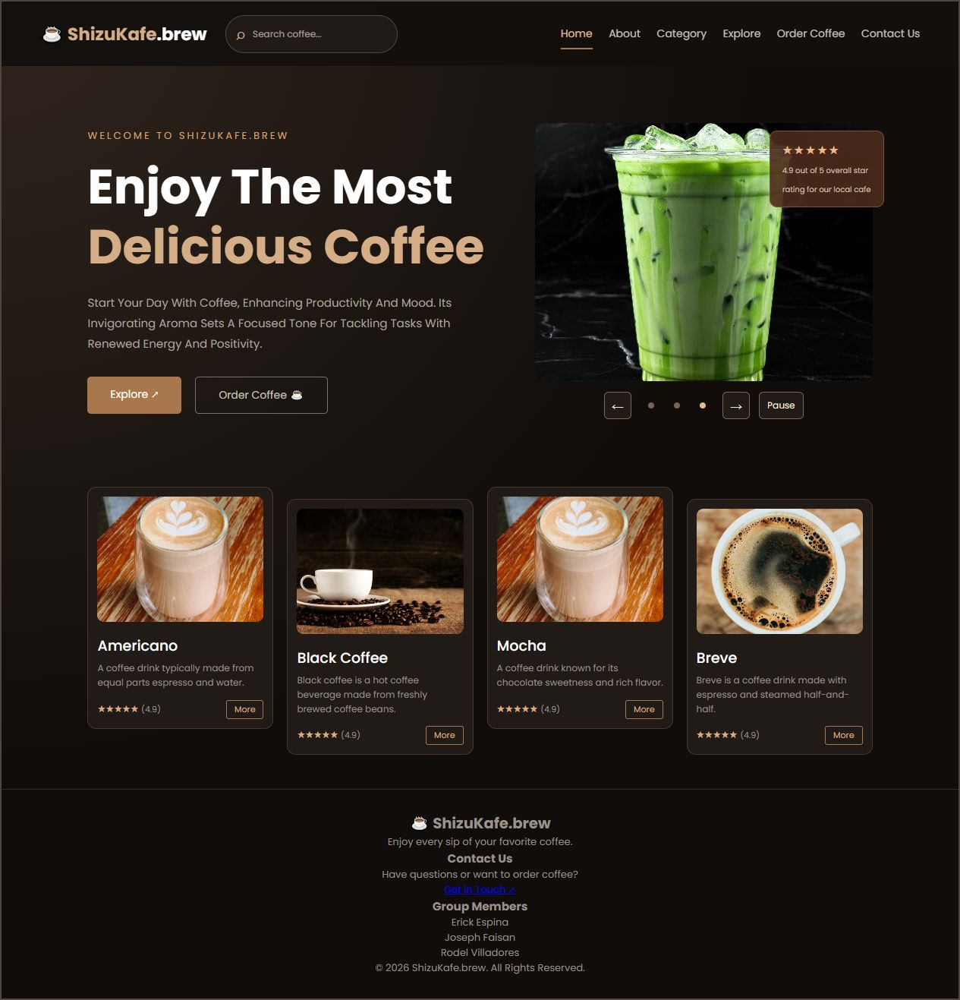
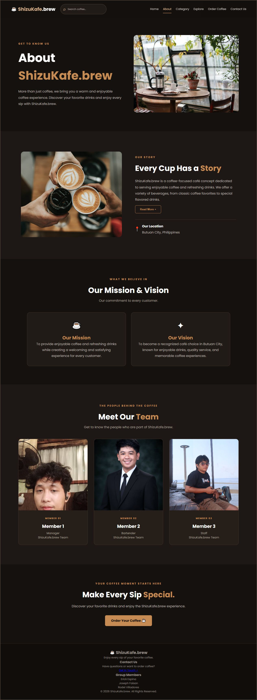
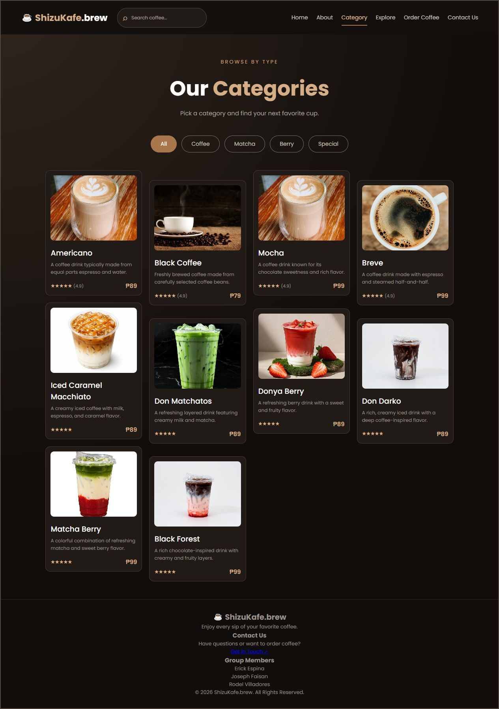
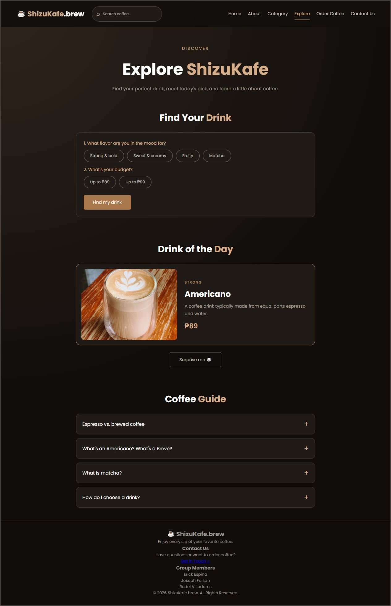
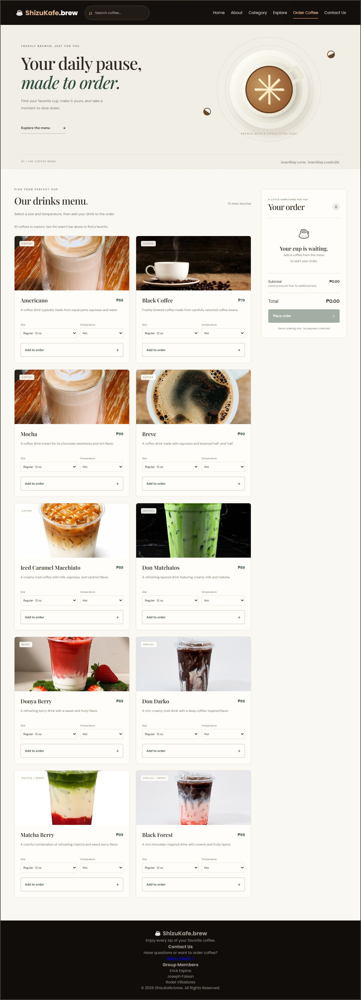
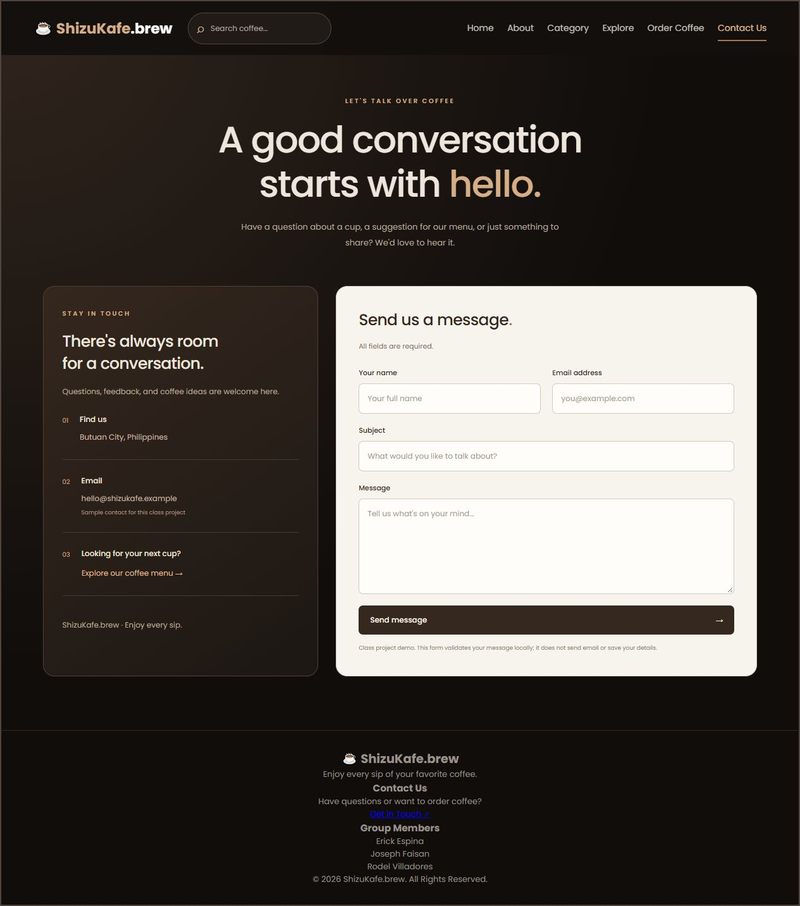

# ShizuKafe.brew

A multi-page Laravel web application for a cafe concept, built with Blade, HTML, CSS, and JavaScript.

## Group information

- **Group / app name:** ShizuKafe.brew
- **Section:** EULM1
- **Members:** Erick Espina, Joseph Faisan, and Rodel Villadores
- **Group leader:** Erick Espina
- **Theme:** A cafe website for browsing coffee, matcha, berry, and specialty drinks.
- **Repository:** https://github.com/erickespina/Lara-Proj-EULM1-Espina-Faisan-Villadores

## Assigned modules and branches

| Member | Assigned modules | Branch |
| --- | --- | --- |
| Erick Espina | Project setup and integration, shared layout/navigation, Home carousel, Order Coffee, search bar, Contact Us | `dev-member1-Espina` |
| Joseph Faisan | Categories and Explore | `dev-member2-Faisan` |
| Rodel Villadores | About, mission/vision, staff cards; originally Our Product, now consolidated into Categories | `dev-member3-Villadores` |

Each member works on their own branch. Changes go into `main` through pull requests. Keep meaningful individual commits and the member branches for assessment.

## Pages and functionality

| Page | Route | Features |
| --- | --- | --- |
| Home | `/` | Cafe introduction, featured drinks, image carousel with arrows, dots, automatic rotation, and Play/Pause |
| About | `/about` | Background, Read More/Read Less, mission and vision, staff cards |
| Categories | `/category` | Ten drink products with images, prices, and category filters |
| Explore | `/explore` | Drink finder, drink of the day, and expandable coffee guide |
| Order Coffee | `/order-coffee` | Size/temperature selection, cart quantities, totals, and demo confirmation |
| Contact Us | `/contact` | Name, email, subject, and message fields with client-side validation and success feedback |

The shared search bar opens Order Coffee from other pages and filters the menu live on the order page. The former `/products` URL redirects to Categories, and `/order` redirects to Order Coffee.

All six pages extend `resources/views/layouts/app.blade.php`. Page assets use `asset()` through `@push('styles')` and `@push('scripts')`; the layout renders the stacks and page content. Page CSS lives in `public/css` and JavaScript in `public/js`.

**Demo limitations:** Orders are not sent to a business and no payments are collected. The contact form validates in the browser; it does not send email or store messages. The sample contact address is not a real mailbox. Some photos and fonts load from external services, so internet access is needed to display those assets.

## Screenshots

Screenshots of the local application are stored in `docs/screenshots`.

### Home



### About



### Categories



### Explore



### Order Coffee



### Contact Us



## Run the project

### Requirements

- PHP 8.3 or newer with the extensions required by Composer, including SQLite/PDO SQLite for the default database.
- Composer 2.
- Git to clone the repository, or download and extract the latest main branch ZIP into a separate folder.
- Laravel Herd can provide the PHP development environment.

The current pages load CSS and JavaScript directly from `public`; an npm/Vite build is not needed for these pages.

### First-time setup

Open a terminal in the folder containing `artisan` and `composer.json`.

If cloning from GitHub:

```sh
git clone --branch main https://github.com/erickespina/Lara-Proj-EULM1-Espina-Faisan-Villadores.git
cd Lara-Proj-EULM1-Espina-Faisan-Villadores
```

Install the locked PHP dependencies:

```sh
composer install
```

Create the local environment file (only if `.env` does not already exist).

Windows PowerShell or Command Prompt:

```powershell
copy .env.example .env
```

Linux/macOS:

```sh
cp .env.example .env
```

Then initialize the application:

```sh
php artisan key:generate
php artisan migrate
php artisan optimize:clear
php artisan serve
```

Answer **yes** if migration asks to create the SQLite database. Keep `DB_CONNECTION=sqlite` in `.env` for this setup. Generate the application key only for a new environment; do not regenerate an existing working key unnecessarily.

Open **http://127.0.0.1:8000**. Keep the server terminal open; stop it with **Ctrl+C**.

If port 8000 is occupied:

```sh
php artisan serve --port=8001
```

Then open **http://127.0.0.1:8001**.

### Start again later

From the same initialized project folder:

```sh
php artisan serve
```

### Update an existing Git clone

Commit or otherwise preserve local work before switching branches or pulling. From a clean working tree:

```sh
git switch main
git pull --ff-only origin main
composer install
php artisan migrate
php artisan optimize:clear
php artisan serve
```

Do not paste a downloaded ZIP over an existing working copy. A ZIP download does not include Git history; use a clone to work with branches and pull requests.

### Troubleshooting

- **PHP or Composer not recognized:** open a new terminal after installing/enabling them through your development environment.
- **Missing vendor/autoload.php:** run `composer install`.
- **Missing application key:** for a new setup, create `.env` and run `php artisan key:generate`.
- **Database or sessions table missing:** verify the SQLite configuration and run `php artisan migrate`.
- **Old page or style still showing:** run `php artisan optimize:clear`, then hard-refresh the browser with Ctrl+F5.
- **Wrong version running:** check the terminal's current folder and the port printed by `php artisan serve`.

Never commit `.env`, `vendor`, or local database contents. Keep the existing ignore rules. Every device installs its own dependencies and creates its own local settings.
